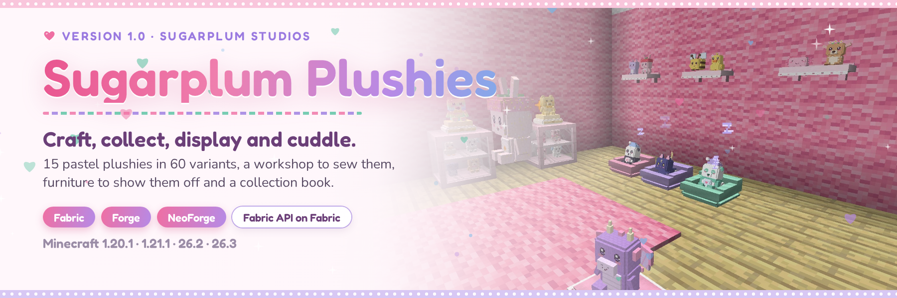

## An adorable collection of pastel plushies to craft, collect, display and cuddle.

**Sugarplum Plushies** adds **15 pastel plushies** to Minecraft, each in **four variants**: three colourways and a rare **Sparkle Edition**, for **60 variants** in all. Sew them in the **Plushie Workshop**, show them off on shelves, display stands, cabinets and little beds, give them names, and track your collection in the **Plushie Collection Book**, with milestone rewards along the way.

Every plushie is a real 3D model with an embroidered face. Right-click it for a cuddle: it plays its own animation, makes its own sound and gives off its own particles. While idle, plushies breathe, bob, sway or hover, and wings, tails, gills and halos move on their own.

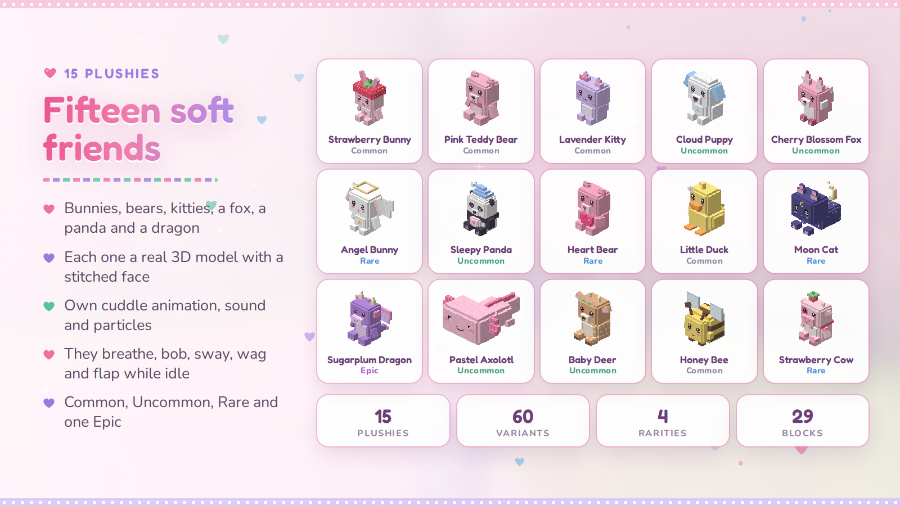

| Plushie | Rarity | Colourways | Cuddle | Idle | Particles and extras |
| --- | --- | --- | --- | --- | --- |
| 🍓 **Strawberry Bunny** | Common | Classic, Vanilla Cream, Blueberry | Double hop | Breathing | Hearts |
| 🧸 **Pink Teddy Bear** | Common | Bubblegum, Honey, Snowflake | Squishy hug | Breathing | Hearts |
| 💜 **Lavender Kitty** | Common | Lavender, Peach, Midnight | Wiggle | Sways, swishes its tail | Hearts |
| ☁️ **Cloud Puppy** | Uncommon | Sky, Sunset, Storm | Bouncy hop | Bobs, wags its tail | Clouds and hearts; a cloud, sun or bolt on its belly |
| 🌸 **Cherry Blossom Fox** | Uncommon | Sakura, Snow Blossom, Twilight | Spin | Sways, swishes its tail | Cherry petals, also while idle |
| 👼 **Angel Bunny** | Rare | Seraph, Blush, Sky | Floats up | Hovers, flaps its wings, spins its halo | Twinkles and sparkles; glows (light 5) |
| 🐼 **Sleepy Panda** | Uncommon | Classic, Strawberry, Mint | Big yawn | Deep sleepy breathing | Zzz's, also while idle; a nightcap and pillow |
| 💗 **Heart Bear** | Rare | Rose, Ruby, Lilac | Heartbeat pulse | Breathing | A shower of hearts; holds a 3D heart |
| 🐤 **Little Duck** | Common | Sunny, Cream, Mint | Waddle | Wobbles | Music notes |
| 🌙 **Moon Cat** | Rare | Midnight, Dawn, Dusk | Twirl | A moon orbits it | Twinkles, more at night; glows (light 7) |
| 🐉 **Sugarplum Dragon** | Epic | Sugarplum, Seafoam, Rose Quartz | Wing-flap hop | Flaps its wings | Sugar sparkles and dragon breath |
| 🩷 **Pastel Axolotl** | Uncommon | Blossom, Mint, Lavender | Wiggle | Waves its gills | Bubbles and splashes |
| 🦌 **Baby Deer** | Uncommon | Fawn, Blossom, Frost | Shy nod | Breathing | Happy sparkles; a flower crown |
| 🐝 **Honey Bee Plushie** | Common | Honey, Strawberry, Mint | Buzz | Hovers, buzzes its wings | Honey drips and hearts |
| 🐄 **Strawberry Cow** | Rare | Strawberry, Chocolate, Blueberry | Hop and moo | Breathing, swishes its tail | Hearts; a bell and a berry hat |

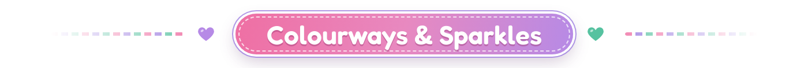

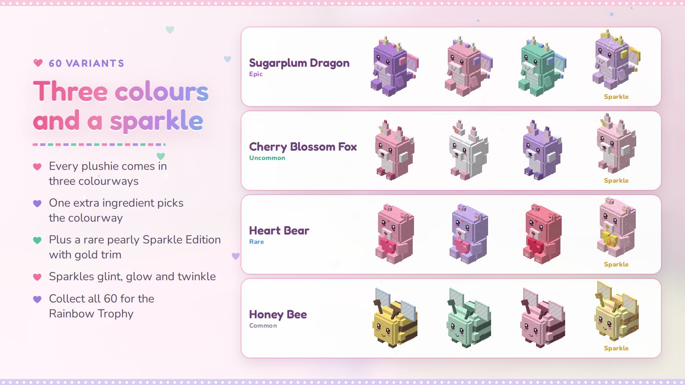

- Every plushie comes in **three colourways**. The classic pattern sews the first; add the right dye (or cocoa beans for the Chocolate cow) to sew the others.
- The **Sparkle Edition** is pearly with gold trim and glitter. It has an enchantment glint, gives off light (at least level 5) and ambient twinkles, and shows a gold *Sparkle Edition* rarity.
- To sew one, upgrade any colourway of that plushie with a Sugar Star, 2 Embroidery Thread and 4 gold nuggets.
- Collect all **60 variants** for the Rainbow Collector's Trophy.

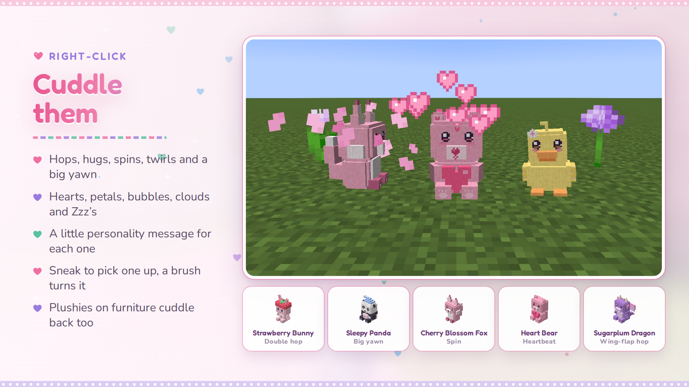

| Do this | What happens |
| --- | --- |
| **Place** a plushie | It turns to face you, in 16 directions |
| **Right-click** with an empty hand | A cuddle: its animation, sound and particles, and a little personality message |
| **Sneak + right-click** with an empty hand | Pick it back up, keeping its variant and name |
| Right-click with a **Brush** | Turn it 22.5° clockwise (sneak for anticlockwise) |
| Right-click with a renamed **Name Tag** | Name it (see **Naming**) |
| **Middle-click** | Pick-block gives you the exact variant |
| **Break** it | It drops with its variant and name |

Plushies need a short rest between cuddles (12 ticks by default), and they can be waterlogged.

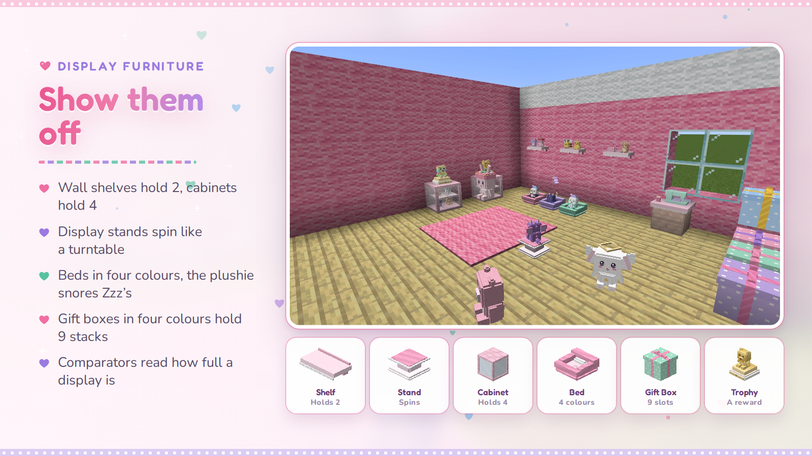

| Block | Holds | Notes |
| --- | --- | --- |
| **Plushie Shelf** | 2 plushies | A wall shelf with lace trim. Place it against a wall |
| **Plushie Display Stand** | 1 plushie | A lace-topped pedestal that slowly turns like a turntable. A brush switches the spin on or off |
| **Plushie Bed** in pink, lavender, mint and sky | 1 plushie | The plushie leans back on the pillow and snores tiny Zzz's |
| **Miniature Display Cabinet** | 4 plushies | Glass-fronted, with two shelves and heart wallpaper |
| **Plushie Gift Box** in pink, lavender, mint and sky | 9 slots | A polka-dot box with a satin bow. Opens like a dispenser |
| **Golden** and **Rainbow Collector's Trophy** | | Collection rewards. They glow (light 6 and 10) and sparkle |

Right-click a shelf, stand, cabinet or bed with a plushie to put it on display. Right-click empty-handed to cuddle the plushie on display (it animates in place), and sneak + right-click to take it back. Comparators read how full a display is.

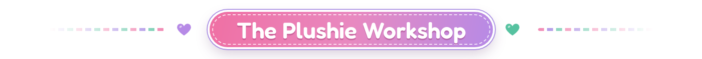

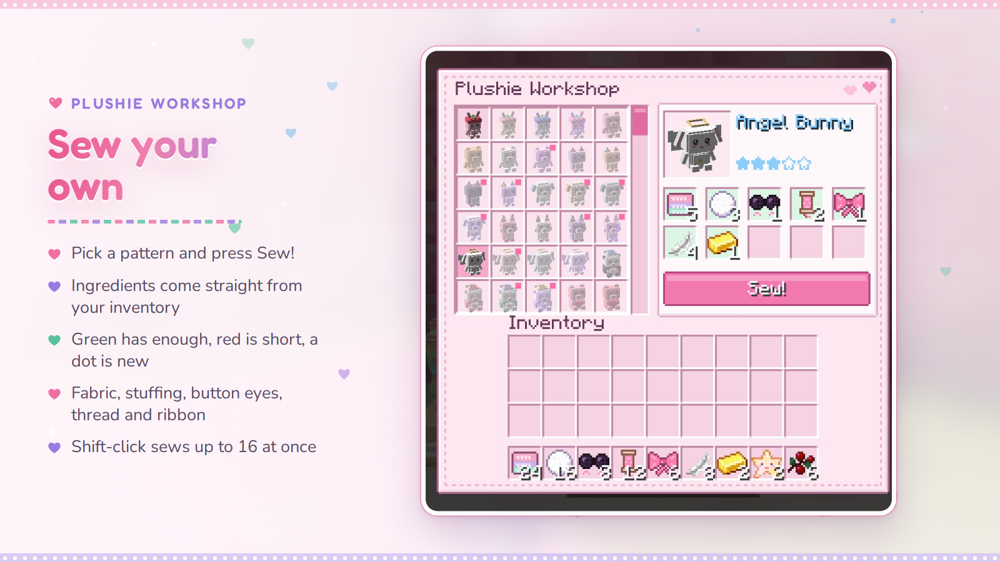

Plushies are sewn in the **Plushie Workshop**. Open it, pick a pattern and press **Sew!** Shift-click sews up to 16 at once.

- The ingredients come straight from your inventory: no grid to fill.
- **Green** slots mean you have enough, **red** means you're short, and a **pink dot** marks plushies you haven't collected yet.
- Rarity sets the cost. Commons need early-game materials; the Rares and the Epic dragon need gold, glowstone, lapis, amethyst, phantom membranes or a Sugar Star.
- When you upgrade to a Sparkle Edition, the Workshop uses ordinary copies first. It only takes a named plushie or a Sparkle Edition if nothing else matches.

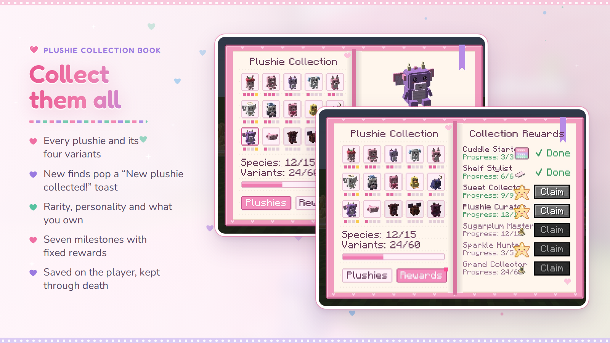

Any plushie that lands in your inventory, from any source, joins your collection, variant by variant, with a **"New plushie collected!"** toast. Your collection is saved on the player and survives death.

The **Plushie Collection Book** shows all 15 plushies, with silhouettes for the ones you haven't found yet, four variant dots each, counters and a progress bar. Click a plushie to see its rarity, its personality and which variants you own. The **Rewards** tab hands out fixed rewards, claimed with a button:

| Milestone | Collect | Reward |
| --- | --- | --- |
| **Cuddle Starter** | 3 plushies | 6 Soft Fabric, 6 Plush Stuffing, 2 Button Eyes |
| **Shelf Stylist** | 6 plushies | 2 Plushie Shelves and a Display Stand |
| **Sweet Collector** | 9 plushies | 2 Sugar Stars and a Display Cabinet |
| **Plushie Curator** | 12 plushies | 4 Sugar Stars and a Pink Plushie Bed |
| **Sugarplum Master** | all 15 plushies | The Golden Collector's Trophy and 4 Sugar Stars |
| **Sparkle Hunter** | 5 Sparkle Editions | 6 Sugar Stars |
| **Grand Collector** | all 60 variants | The Rainbow Collector's Trophy |

There are advancements too: *A New Friend*, *Dear Diary...*, *Sparkle Edition!*, *Here Be (Cute) Dragons*, *Sugarplum Master* and *Every Last Stitch*.

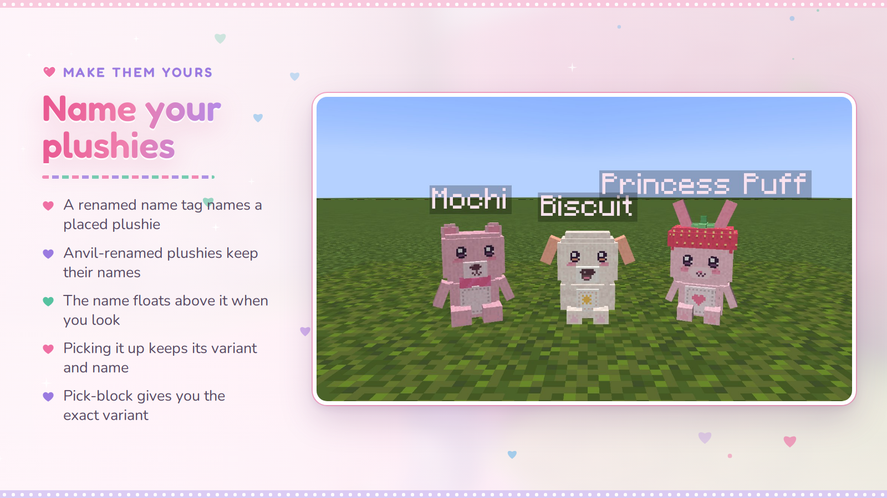

- Right-click a placed plushie with a **renamed name tag** to name it. The tag is used up, unless you're in creative or the server turns that off.
- Plushies renamed in an **anvil** keep their names when you place them.
- The name floats above the plushie when you look at it. Each player can show names always, when looking, or never.
- Picking a plushie up or breaking it keeps its name and variant.

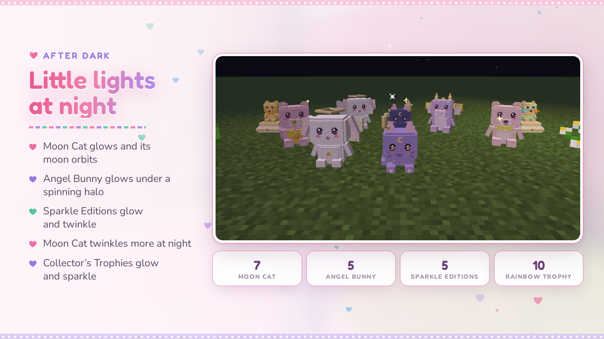

| Gives off light | Level |
| --- | --- |
| Moon Cat | 7 |
| Angel Bunny | 5 |
| Every Sparkle Edition | 5 (7 for the Moon Cat) |
| Golden Collector's Trophy | 6 |
| Rainbow Collector's Trophy | 10 |

The materials and furniture are made on a crafting table; the plushies are sewn in the Workshop.

| Item | Recipe |
| --- | --- |
| Soft Fabric ×3 | 2 wool and a string |
| Plush Stuffing ×4 | Wool and a feather |
| Button Eyes ×4 | Black dye and any button |
| Embroidery Thread ×2 | String and any dye |
| Satin Ribbon ×3 | String, pink dye, string |
| Sugar Star | Sugar, 2 glowstone dust and 2 amethyst shards |
| Plushie Workshop | Wool, an iron ingot, a crafting table and planks |
| Plushie Collection Book | A book, Soft Fabric and Satin Ribbon |
| Plushie Shelf ×2 | Wooden slabs, Satin Ribbon and sticks |
| Plushie Display Stand | Soft Fabric over planks over a wooden slab |
| Miniature Display Cabinet | Planks, glass panes and a Plushie Shelf |
| Plushie Bed | Plush Stuffing, Soft Fabric and coloured wool |
| Plushie Gift Box | Paper, Satin Ribbon and a dye |

A few Workshop patterns (F = Soft Fabric, S = Plush Stuffing, E = Button Eyes, T = Embroidery Thread, R = Satin Ribbon):

| Plushie | Classic pattern |
| --- | --- |
| Strawberry Bunny | 3F 2S 1E and 2 sweet berries |
| Little Duck | 3F 2S 1E, 2 feathers and yellow dye |
| Cherry Blossom Fox | 4F 3S 1E 1T and 2 pink petals |
| Moon Cat | 5F 3S 1E 2T 1R, 2 glowstone dust and 2 lapis |
| Sugarplum Dragon | 6F 4S 1E 3T 1R, a Sugar Star, 2 phantom membranes and 2 amethyst shards |

On Minecraft 1.20.1 and 1.21.1, **wandering traders** sell a Sugar Star for 5 emeralds, 6 Soft Fabric for 2 emeralds, and now and then a Common or Uncommon plushie for 12 emeralds. Every price is fixed and shown up front: **no random loot boxes and no real-money mechanics.**

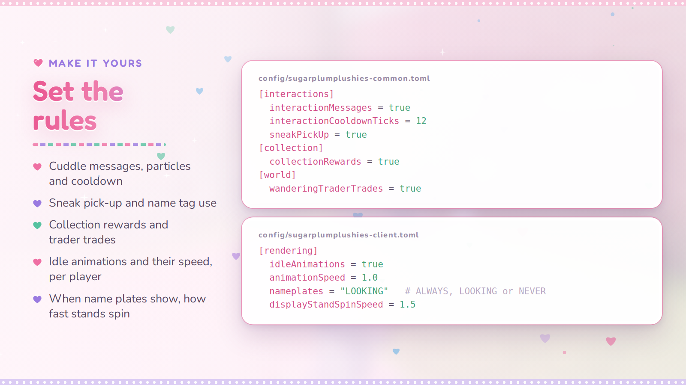

`config/sugarplumplushies-common.toml` holds the server rules:

| Setting | Default | |
| --- | --- | --- |
| `interactions.interactionMessages` | `true` | A personality message above the hotbar on a cuddle |
| `interactions.interactionParticles` | `true` | Particles on a cuddle |
| `interactions.interactionCooldownTicks` | `12` | Rest between cuddles (0–200) |
| `interactions.sneakPickUp` | `true` | Sneak + right-click picks a plushie up |
| `interactions.consumeNameTags` | `true` | Naming uses up the tag (never in creative) |
| `collection.collectionRewards` | `true` | Milestone rewards can be claimed |
| `collection.inventoryScanIntervalTicks` | `20` | How often inventories are checked for new plushies (5–200) |
| `world.wanderingTraderTrades` | `true` | The wandering trader's plushie trades (Minecraft 1.20.1 and 1.21.1) |

`config/sugarplumplushies-client.toml` is set by each player:

| Setting | Default | |
| --- | --- | --- |
| `rendering.idleAnimations` | `true` | Breathing, bobbing, swaying, flapping and wagging |
| `rendering.animationSpeed` | `1.0` | 0.25 to 3 |
| `rendering.ambientParticles` | `true` | Petals, Zzz's and twinkles while idle |
| `rendering.nameplates` | `LOOKING` | `ALWAYS`, `LOOKING` or `NEVER` |
| `rendering.displayStandSpin` | `true` | |
| `rendering.displayStandSpinSpeed` | `1.5` | Degrees per tick (0.1 to 10) |
| `collection.unlockToasts` | `true` | The "New plushie collected!" toast |

- **One creative tab:** *Sugarplum Plushies*, with every variant.
- **Multiplayer-ready:** collections, rewards and displays all live on the server.
- **Gift boxes** work with hoppers and comparators, and displays give a comparator signal.

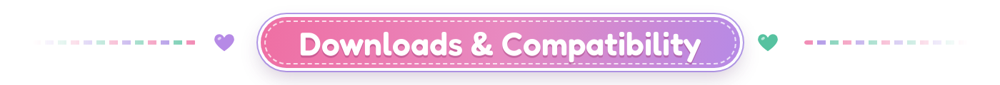

| Minecraft | Loader | Java | Also install |
| --- | --- | --- | --- |
| 1.20.1 | Forge 47 or newer | 17+ | Nothing |
| 1.20.1 | Fabric | 17+ | Fabric API |
| 1.21.1 | NeoForge | 21+ | Nothing |
| 1.21.1 | Fabric | 21+ | Fabric API |
| 26.2 | NeoForge | 25+ | Nothing |
| 26.2 | Fabric | 25+ | Fabric API |
| 26.3 | NeoForge | 25+ | Nothing |
| 26.3 | Fabric | 25+ | Fabric API |

- Install Sugarplum Plushies on **both the server and every client**.
- Sugarplum Plushies is a mod. It does not work as a Paper, Spigot or Folia plugin.

**Does it need any other mods?**
No. On Forge and NeoForge it needs nothing else; on Fabric it needs Fabric API.

**Are there loot boxes or random rewards?**
No. Every recipe, trade and milestone reward is fixed and shown up front. The only chance involved is which plushie a wandering trader happens to have.

**How do I get a Sparkle Edition?**
Sew it in the Workshop: any colourway of that plushie, a Sugar Star, 2 Embroidery Thread and 4 gold nuggets.

**Where do I get Sugar Stars?**
Craft them from sugar, glowstone dust and amethyst shards, buy them from wandering traders (Minecraft 1.20.1 and 1.21.1), or earn them from collection milestones.

**Does my collection carry over between worlds?**
It's saved with your player on each world or server, and it survives death.

**Can I stop plushies from moving?**
Yes. Turn off `rendering.idleAnimations` in your client config, or slow them down with `rendering.animationSpeed`.

**Is there a Fabric or NeoForge version?**
Yes. Sugarplum Plushies runs on Fabric and Forge for Minecraft 1.20.1, and on Fabric and NeoForge for Minecraft 1.21.1, 26.2 and 26.3. Pick the file that matches both your Minecraft version and your loader.

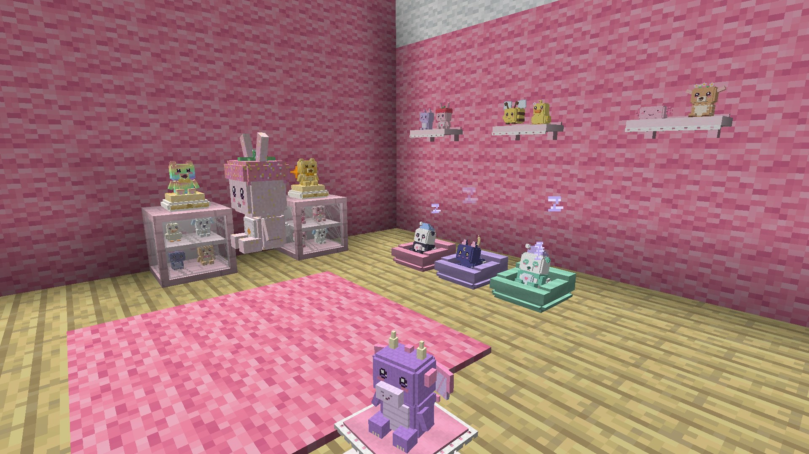

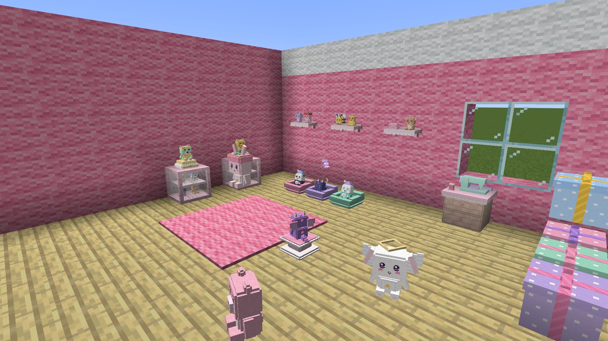

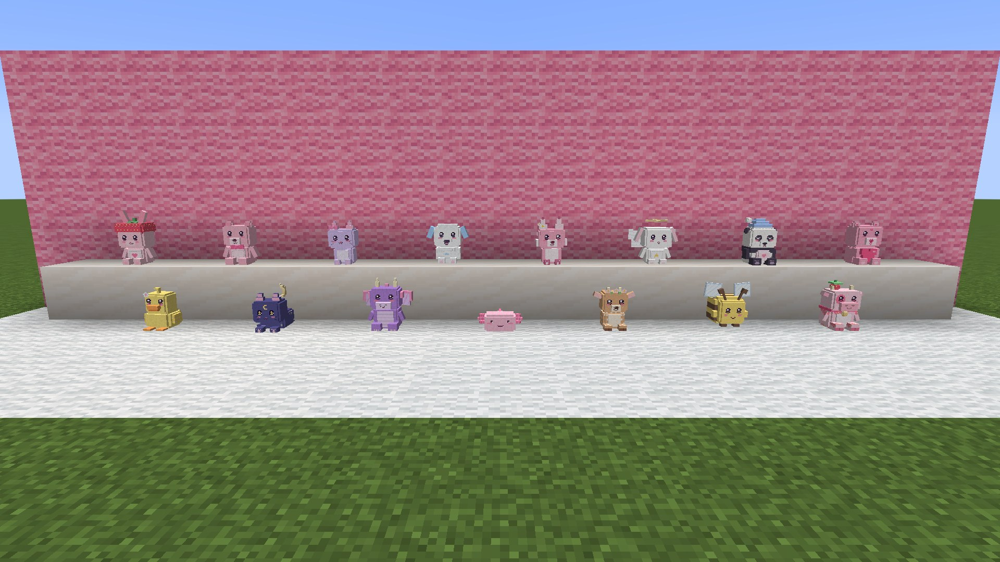

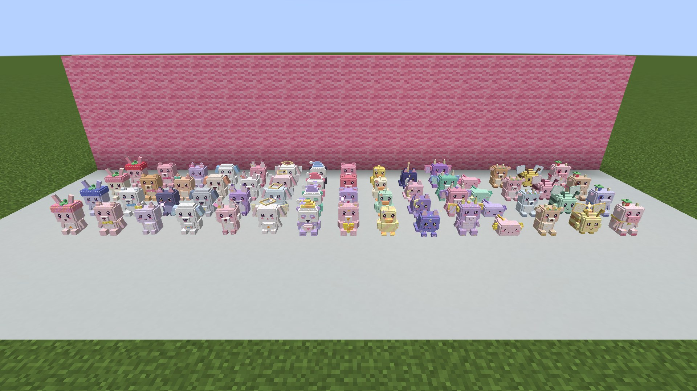

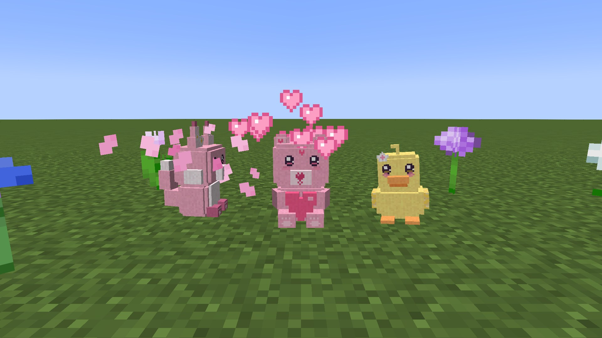

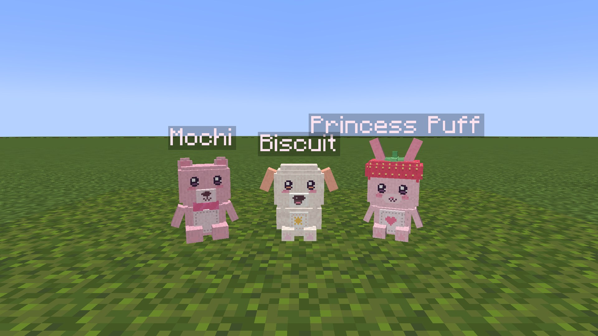

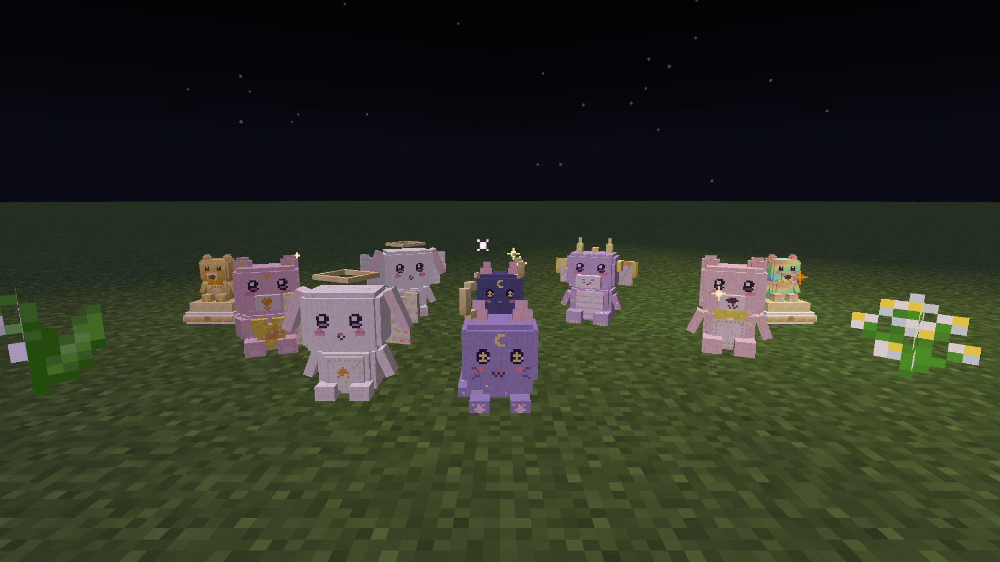

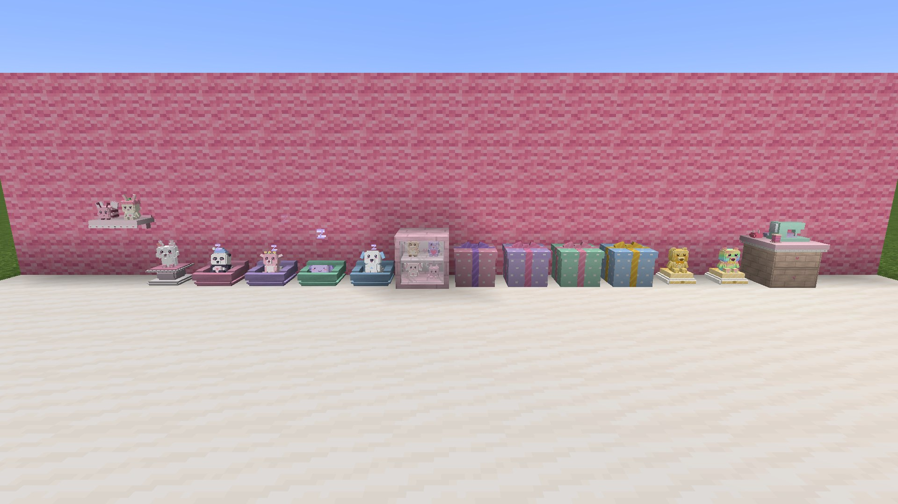

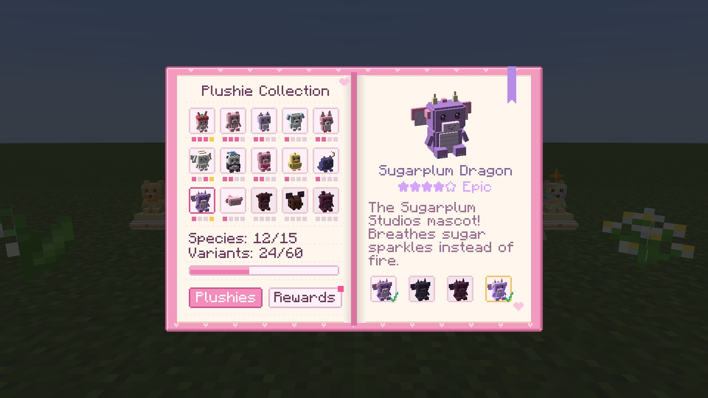

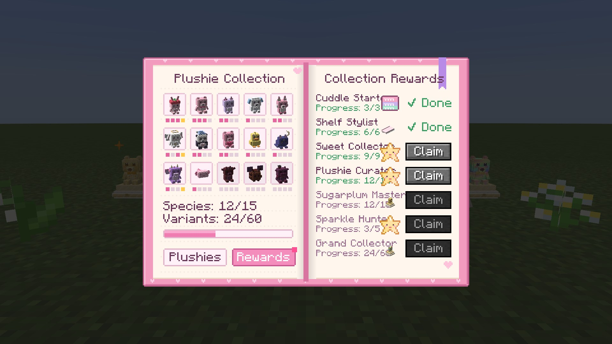

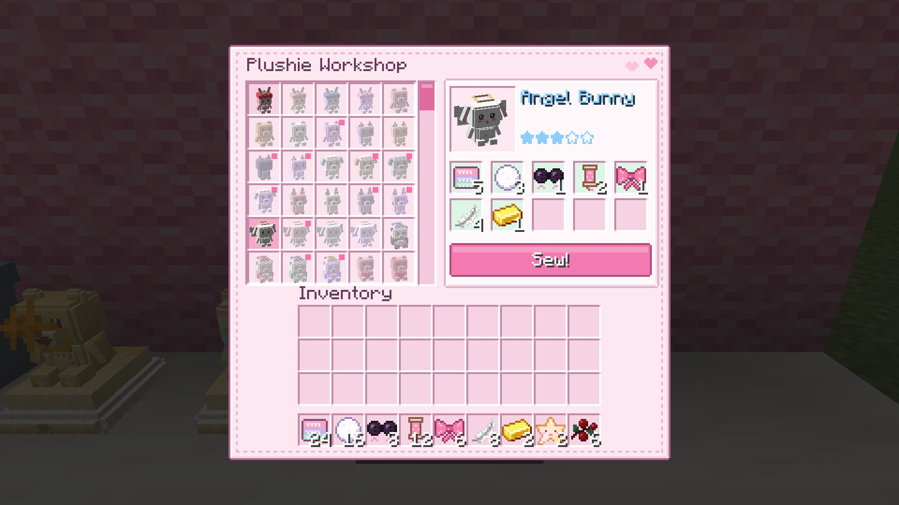

---

Sugarplum Plushies is made by Sugarplum Studios and released under the Apache License 2.0. The Fredoka and Nunito fonts used in this artwork are licensed under the SIL Open Font License 1.1.
